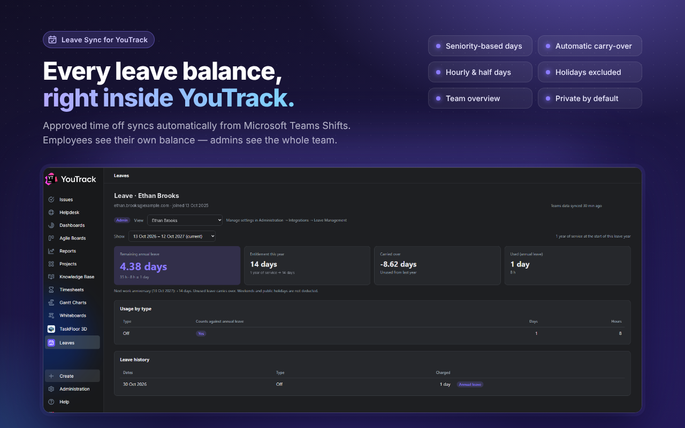
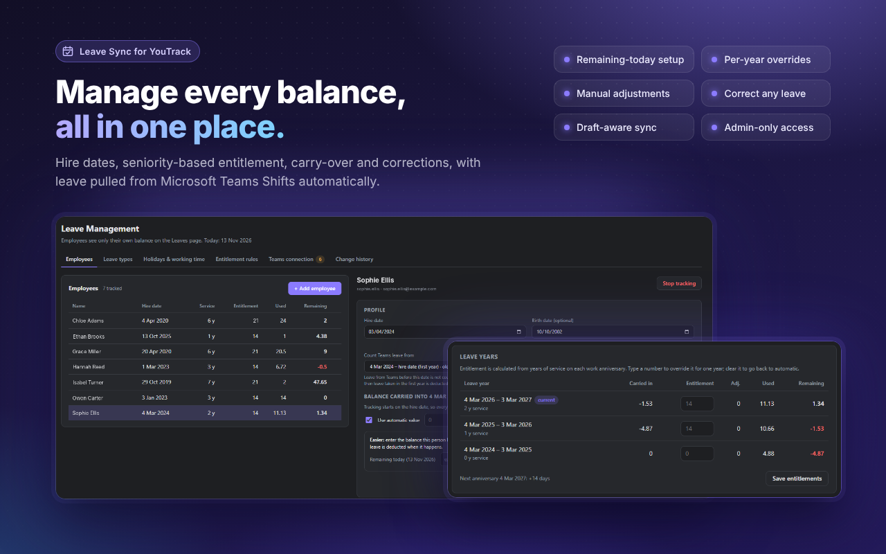
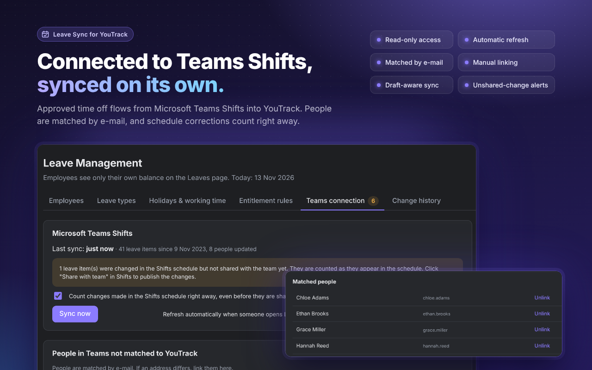
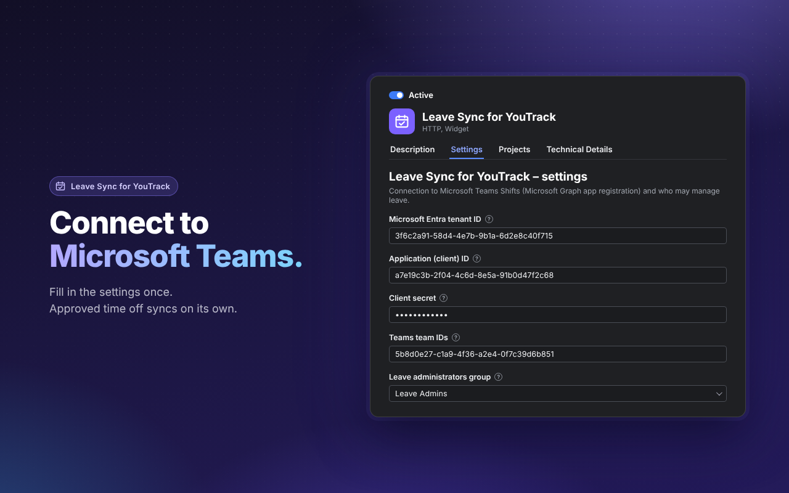
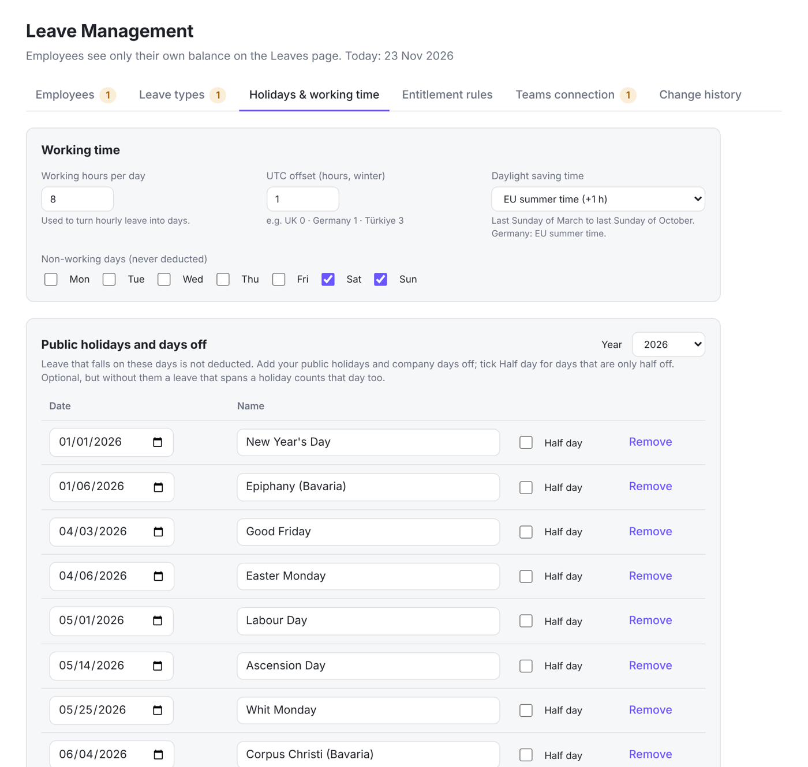

# Leave Sync for YouTrack

A YouTrack app that reads approved time off from **Microsoft Teams Shifts** and shows leave balances inside YouTrack.

Every employee gets a **Leaves** page in the YouTrack main menu with their own remaining annual leave, how much they used of each leave type and their leave history. Administrators see the whole team and manage hire dates, entitlements, carry-over, leave types, public holidays and the Teams connection.



---

## Contents

- [Features](#features)
- [How it works](#how-it-works)
- [Requirements](#requirements)
- [Installation](#installation)
  - [Try it with demo data](#try-it-with-demo-data)
- [Connecting Microsoft Teams](#connecting-microsoft-teams)
- [Configuring leave](#configuring-leave)
- [Calculation rules](#calculation-rules)
- [When leave in Teams is wrong](#when-leave-in-teams-is-wrong)
- [Troubleshooting](#troubleshooting)
- [Ongoing administration](#ongoing-administration)
- [Privacy and permissions](#privacy-and-permissions)
- [Project structure](#project-structure)
- [Development](#development)
- [Updating the app](#updating-the-app)
- [Roadmap](#roadmap)
- [License](#license)

---

## Features

**For every employee** (Leaves, main menu)
- Remaining annual leave in days and hours for the current leave year
- Entitlement this year, carried-over days, used annual leave and manual adjustments
- Usage grouped by Teams time-off reason, with a note on whether each type counts against annual leave
- Full leave history with labels: *upcoming*, *Corrected*, *Updated by manager*, *Before tracking*
- Period selection: leave years (anniversary to anniversary), calendar years or a custom date range
- Employees only ever receive their own data

**For leave administrators**
- **View picker** on the Leaves page: *My leave*, *Team overview* (one row per employee with totals) or any employee's page exactly as they see it
- **Leave Management** under *Administration → Integrations*:
  - Employees, hire dates, optional birth dates and starting balances
  - Automatic entitlement by years of service, with per-year overrides
  - Automatic carry-over of unused leave on every work anniversary
  - Manual adjustments with a required reason
  - Corrections of individual Teams leave items (different number of days/hours, or excluded)
  - Leave types: choose which Teams reasons are deducted from annual leave
  - Public holidays (built-in Türkiye and Germany, or none) plus your own days off
  - Working hours per day, non-working days, company time zone and EU summer time
  - Teams connection status, manual sync, automatic refresh and linking of people whose e-mail differs
  - Change history of every administrative change

**Leave counting**
- Weekends and public holidays are never deducted; half-day holidays count as half a day
- Full-day, half-day and hourly leave are supported
- Changes a manager makes in the Shifts schedule count right away, even before they are shared with the team

| Leave Management | Teams connection |
|---|---|
|  |  |

---

## How it works

```
Microsoft Teams Shifts ──(Microsoft Graph, read-only)──► YouTrack app backend ──► Leaves / Leave Management widgets
                                                          │
                                                          └─ stored in YouTrack (entity extension properties)
```

1. The app signs in to Microsoft Graph with an Entra app registration (client credentials flow).
2. It reads the time-off reasons and the approved time off of the configured Teams teams.
3. Each Teams user is matched to a YouTrack user by e-mail (or by a manual link).
4. Leave is stored only for employees an administrator has added, then counted per local working day.
5. Data refreshes when someone opens Leaves and it is older than the refresh interval (default 30 minutes), or when an administrator clicks **Sync now**.

All Microsoft requests are **asynchronous**: the endpoint that starts a sync answers immediately, and the work continues in YouTrack async functions (`onToken`, `onBatch`). Graph requests are grouped with JSON batching (up to 20 per call), Teams users that can't be matched are looked up at most once a week, and very large schedules continue in a follow-up chain. The widgets poll `api/sync-status` and re-render when the sync is done.

---

## Requirements

- YouTrack 2026.2 or later (Cloud or Server) with permission to install apps
- A Microsoft 365 administrator who can register an app and grant admin consent (Global Administrator or Privileged Role Administrator)
- A team in Microsoft Teams that uses **Shifts** for time-off requests
- For each employee: hire date, optional birth date, and how many leave days they have left today

---

## Installation

1. Build the package (or take a release zip):
   ```sh
   cd app && zip -r ../leave-sync-for-youtrack.zip . -x README.md
   ```
2. In YouTrack go to **Administration → Apps → Add app → Upload ZIP file** and select the zip.
3. Make sure the app is **Active** and its visibility allows all users, so everyone sees the **Leaves** menu item.

### Try it with demo data

No Microsoft 365 tenant yet? In the app settings tick **Use demo data (no Microsoft connection)**, add a few employees on the **Employees** tab and open **Leaves**. The app generates sample Teams Shifts time off for every employee you add, relative to today:
- vacations, one of them spanning a weekend;
- a half day and an hourly sick leave;
- leave around New Year's Day, which is a public holiday;
- upcoming leave;
- a request a manager shortened without sharing it yet;
- a deleted request that is not counted.

The sample data goes through the same sync and calculation code as real data, including e-mail matching and two Teams people who can't be matched automatically. Microsoft is never contacted. Untick the setting to sync real data: demo leave is then replaced by your Teams data, while employees, hire dates and settings are kept.

---

## Connecting Microsoft Teams

Setup takes about 15 minutes.



### 1. Register an app in Microsoft Entra ID
1. Sign in to [entra.microsoft.com](https://entra.microsoft.com) and open **Identity → Applications → App registrations** (not *Enterprise applications*).
2. Click **+ New registration**:
   - **Name:** `Leave Sync for YouTrack` (any name works)
   - **Supported account types:** *Accounts in this organizational directory only (Single tenant)*
   - **Redirect URI:** leave empty
3. Click **Register**. On the **Overview** page copy the **Application (client) ID** and the **Directory (tenant) ID**.

### 2. Grant Microsoft Graph permissions
1. Open **API permissions → + Add a permission → Microsoft Graph → Application permissions** (not *Delegated*).
2. Add:
   - `Schedule.Read.All` – reads time off and time-off reasons from Shifts
   - `User.Read.All` – matches Teams users to YouTrack users by e-mail
3. Click **Grant admin consent for &lt;your organization&gt;**. Both permissions must show *Granted*.

### 3. Create a client secret
1. Open **Certificates & secrets → Client secrets → + New client secret** (for example *Description:* `YouTrack`, *Expires:* 24 months).
2. Copy the **Value** right away (not the *Secret ID*). It is shown only once.
3. Put the expiry date in your calendar.

### 4. Find your Team ID
1. In Microsoft Teams open the team that uses Shifts, then **⋯ → Copy link** (older Teams: *Get link to team*).
2. The Team ID is the value after `groupId=` up to the next `&`, for example `1a2b3c4d-1111-2222-3333-444455556666`.
3. Don't use the `19%3A…thread.tacv2` part; it is a different identifier. Alternatively, the team's group **Object ID** in *Entra → Groups* is the Team ID.

### 5. Enter the settings in YouTrack
In **Administration → Apps → Leave Sync for YouTrack → Settings**:

| Field | Value |
|---|---|
| Use demo data | leave unticked for real data (see [Try it with demo data](#try-it-with-demo-data)) |
| Microsoft Entra tenant ID | Directory (tenant) ID from step 1 |
| Application (client) ID | from step 1 |
| Client secret | secret **Value** from step 3 |
| Teams team IDs | from step 4; separate several with commas |
| Leave administrators group | optional; members manage leave and see the whole team. System administrators always can. |

> ⚠️ **Watch out for browser autofill.** Browsers often put your e-mail address into *tenant ID* and a saved password into *Client secret*. Check every field before saving.

### 6. Test the connection
Open **Administration → Integrations → Leave Management → Teams connection** and click **Sync now**. You should see *Last sync: just now · N leave items since &lt;date&gt;*. *0 people updated* is normal until you add employees.

---

## Configuring leave

Everything below is in **Administration → Integrations → Leave Management**.

1. **Leave types** – tick the Teams reasons that are deducted from annual leave (usually *Vacation*/*Off*). Unticked types are counted and shown but not deducted. New reasons appear as *Needs review*.
2. **Holidays & working time**
   - Built-in public holidays: *Türkiye*, *Germany (nationwide)* or *None*. Easter-based dates are calculated every year.
   - Add regional, religious or company days off under **Other days off** (full or half day).
   - Time zone: Germany `UTC+1` with *EU summer time*; Türkiye `UTC+3` with *None*.
   - Hours per working day (default 8) and non-working days (default Sat/Sun).

   
3. **Entitlement rules** – annual leave by years of service and an optional age rule.
4. **Employees → + Add employee** – pick the person and enter the hire date. Their leave is loaded from Teams right away. Then:
   - Enter **Remaining today** and click **Calculate** to set the starting balance.
   - Leave the **Entitlement** of a leave year empty for the automatic value; type a number only to override that year.
   - Tick **Checked and confirmed** and click **Save profile**.
5. **Teams connection → People in Teams not matched to YouTrack** – link anyone whose e-mail differs, then **Sync now**. *Unknown* entries are usually deleted or guest accounts.

Finally, open **Leaves → View → Team overview** and compare a few balances with your own records.

---

## Calculation rules

| Topic | Behaviour |
|---|---|
| Leave year | From one work anniversary to the next |
| Annual entitlement (default) | 1–5 years of service: **14 days**, 6–14 years: **21 days**, 15+ years: **26 days** (editable in *Entitlement rules*) |
| Age rule (optional) | Employees aged 18 or younger, or 50 or older, get at least 20 days (needs a birth date) |
| Carry-over | Unused leave moves into the next leave year on the work anniversary |
| Counting | Hours-based per local day; a full day equals the working hours per day (default 8) |
| Weekends & holidays | Never deducted; half-day holidays count as half a day |
| Hourly / half-day leave | Counted by the hours taken, capped at the day's working hours |
| Tracking start | Teams leave before *Count Teams leave from* is ignored because it is already included in the carried-in balance. People hired within roughly the last 13 months start at their hire date. |
| Overrides | Per-year entitlement overrides, manual adjustments and per-leave corrections, each recorded in Change history |

The defaults follow Turkish labour law; all values can be changed by an administrator.

---

## When leave in Teams is wrong

- **Preferred:** fix the time off in the Shifts schedule and click **Share with team**. The change counts at the next sync even before it is shared and is marked *not shared in Teams* until then.
- **Otherwise:** *Employees → the person → Leave from Teams → Correct*. Charge a different number of days or hours, or exclude the leave. A note is required and the employee sees it. The correction survives every sync until you click **Reset to Teams**.

---

## Troubleshooting

| Message / symptom | Cause and fix |
|---|---|
| `AADSTS900023 … tenant identifier '<e-mail>'` | The browser autofilled your e-mail into the tenant ID field. Enter the Directory (tenant) ID and re-enter the client secret. |
| `AADSTS7000215` / invalid client secret | The Secret ID was copied instead of the Value, a password was autofilled, or the secret expired. |
| HTTP 401 / 403 from Microsoft Graph | Admin consent is missing, or Delegated permissions were added instead of Application permissions. |
| HTTP 404 for a team | Wrong Team ID (for example the `19:…thread.tacv2` part), or the team has no Shifts schedule. |
| Old error still shown after fixing settings | It is the previous attempt. Click **Sync now** and reload. |
| "Your leave profile is not set up yet" | The user hasn't been added on the Employees tab (applies to admins too). |
| A person's leave is missing | Their e-mail differs between Teams and YouTrack. Link them on the Teams connection tab. |
| Leave marked *before tracking* | It is before *Count Teams leave from*. Pick an earlier date or include it in the balance. |
| Leave shows as *not deducted* | The leave type isn't ticked on the Leave types tab. |

---

## Ongoing administration

- **New employee:** Employees → Add employee.
- **Employee leaves:** select them → **Stop tracking**. Data is kept; adding them again restores it.
- **Every year:** add holidays that aren't built in (religious holidays in Türkiye, regional holidays in Germany).
- **New reason in Teams:** review it on the Leave types tab.
- **Before the client secret expires:** create a new one in Entra and update the app settings.

---

## Privacy and permissions

- Microsoft Graph access is **read-only** (`Schedule.Read.All`, `User.Read.All`, application permissions).
- Data is stored inside your YouTrack instance (entity extension properties on users and app global storage). Nothing is sent to third parties.
- Access checks run on the server: employees only receive their own data; only System Administrators and members of the *Leave administrators* group can see other people's leave or change anything.
- The client secret is stored as a secret app setting and is never returned to the browser.
- Full details: [Privacy Policy](PRIVACY.md).

---

## Project structure

| Path | Contents |
|---|---|
| `app/manifest.json` | App definition. `name` (`leave-tracker`) is the technical ID and **must not change**; `title` is the display name. |
| `app/settings.json` | App settings: tenant ID, client ID, client secret, team IDs, leave administrators group |
| `app/entity-extensions.json` | Stored data: `User.leaveEnabled`, `User.leaveProfile`, `User.leaveRecords`, `AppGlobalStorage.leaveConfig`, `AppGlobalStorage.leaveAudit` |
| `app/engine.js` | Leave calculation – pure functions with no YouTrack dependency (leave years, entitlement, carry-over, holidays, time zones, overrides) |
| `app/demo-data.js` | Sample Teams Shifts data for demo mode, shaped like Microsoft Graph responses |
| `app/teams-sync.js` | Asynchronous Microsoft Graph sync: token, batched requests for time-off reasons, time off (incl. unshared schedule changes) and user matching |
| `app/api.js` | HTTP endpoints used by the widgets (employee and admin endpoints) |
| `app/store.js` | Reading and writing stored data, change history |
| `app/widgets/leaves/` | **Leaves** main menu page |
| `app/widgets/leaves-admin/` | **Leave Management** administration page |
| `app/widgets/common.*` | Shared UI helpers and styles |
| `marketplace/` | Getting Started guide and listing description for JetBrains Marketplace |
| `test/engine.test.js` | Unit tests for the calculation engine |
| `test/api.test.js` | API tests with mocked YouTrack entities and Microsoft Graph |
| `test/preview-server.js`, `test/shot-server.js` | Local preview servers with sample data |
| `test/async-http-mock.js` | Async HTTP mock used by the preview servers |
| `docs/images/` | Screenshots used in this README (sample data only) |

---

## Development

Requires Node.js 18 or newer. There are no npm dependencies.

```sh
# Tests
node test/engine.test.js
node test/api.test.js

# Local preview with sample data
node test/shot-server.js
# then open http://localhost:8765/leaves/index.html
#       and  http://localhost:8765/leaves-admin/index.html

# Preview with German holidays and EU summer time
PRESET=DE node test/preview-server.js
```

Build the YouTrack package:

```sh
cd app && zip -r ../leave-sync-for-youtrack.zip . -x README.md
```

---

## Updating the app

Upload the new zip over the existing app in **Administration → Apps**. **Do not delete the app first** – deleting it removes all of its data. Keep `name` in `manifest.json` unchanged, otherwise YouTrack installs the zip as a separate app.

---

## Roadmap

Done in 1.3.0: asynchronous Microsoft requests, `minYouTrackVersion` 2026.2, privacy policy.
Done in 1.4.0: demo mode (try the app without Microsoft 365).

Planned:
- UI follows the YouTrack theme only (no separate theme toggle)
- `ADMIN_UPDATE_APP` permission for app-wide settings
- Input size limits
- Optional German-style entitlement (full leave from the first year)

---

## License

Licensed under the [Apache License 2.0](LICENSE).
